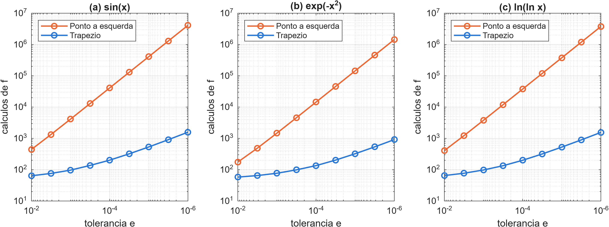
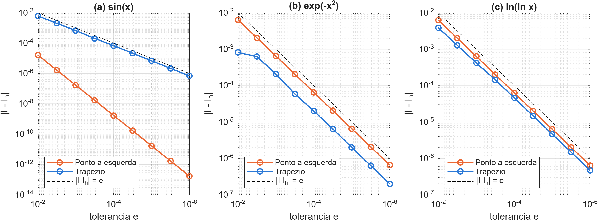

# Non-iterative adaptive integration (MATLAB)

Coursework project for *Introduction to Computational Methods in Biomedicine*, BSc in Biomedical Engineering, Instituto Superior Técnico, 2026/27. Group of 3 students. Comments and figures are in Portuguese.

## What it does

Computes an integral to a requested tolerance without iterating. The interval is split into three pieces, the derivative in the error formula is estimated by finite differences in each piece, and the number of subintervals follows directly from it. Two rules are compared: left endpoint and trapezoidal.

| File | Purpose |
|---|---|
| `integ_adapt.m` | Adaptive integration |
| `majorante.m` | Estimate of the maximum of the first or second derivative |
| `main_integ.m` | Tests on sin(x), exp(−x²) and ln(ln x) |
| `main_debito.m` | Cardiac output from thermodilution data |
| `anexos_testes.m` | Extra tests (points used, finite difference step, time and memory) |

## Main results

Tolerance 1e-5, function evaluations:

| Function | Left endpoint | Trapezoidal |
|---|---|---|
| sin(x), [0, π] | 411 265 | 534 |
| exp(−x²), [0, 2] | 144 380 | 324 |
| ln(ln x), [1.5, 5] | 376 329 | 527 |

- The actual error stayed below the tolerance in every case tested, from 1e-2 to 1e-6.
- The left endpoint rule needed about 450 to 770 times more evaluations than the trapezoidal rule at 1e-5.
- **Cardiac output:** both rules give an area of 7.60 °C·s against a reference of 7.25 °C·s (4.83 % error). They agree because the curve starts and ends at zero. This part applies the two rules directly to the nine given samples, and the data are a classroom example.

## How to run

Put all files in one folder and run `main_integ.m` or `main_debito.m`.

## Limitation

The derivative bound is the largest value found at 5 points in each piece. It is an estimate and not a guaranteed bound.
